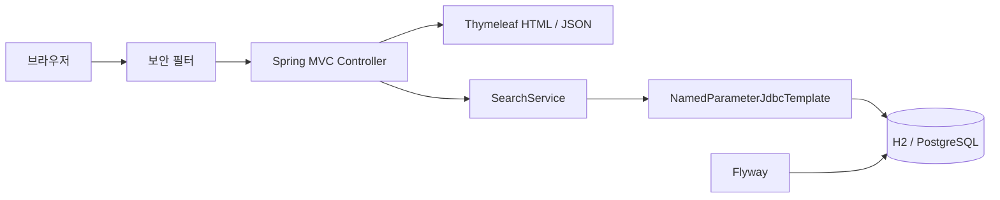

# 집결 — 아파트 실거래가 검색

지역·가격·면적·계약 기간으로 아파트 거래를 검색하고, 거래 상세와 동일 면적의 가격 흐름을 확인하는 웹 프로젝트입니다.

**현재 단계: AWS HTTPS 공개 배포 완료(2026-10-29). 종로구 32건과 청주시 694건, 총 726건의 실제 거래를 조회할 수 있습니다. 기본 demo의 240건은 가상 데이터이며, 전국 전체 데이터 수집과 대용량 성능 검증은 완료되지 않았습니다.**

🌐 **[배포 사이트 열기](https://3-107-167-57.sslip.io/)**

청주 거래는 지역 `충북`, 검색어 `청주시`, 계약 기간 `2026-09-01 ~ 2026-09-30`으로 조회하세요. 무료 IP 기반 주소이므로 서버 중지·IP 변경 시 접속 주소나 운영 상태가 달라질 수 있습니다.

집결 검색 화면 — 가상 거래 데이터

!집결 검색 화면 — 가상 거래 데이터

집결 검색 화면 — 가상 거래 데이터

## 구현한 기능

- 지역, 단지명/시·군·구, 가격, 기간, 면적 조건 검색
- 최근순·가격순 정렬, 검색 조건을 유지하는 12건 단위 페이지 이동
- 거래 상세 및 동일 주소·단지·면적의 최근 최대 12건 비교
- 브라우저 localStorage 기반 관심 저장
- 잘못된 입력·없는 거래·빈 검색 결과 처리
- 보안 헤더, 요청 횟수 제한, SQL 쿼리 시간 제한

관심 저장은 계정 간 동기화를 지원하지 않습니다. 데모 DB는 서버 재시작 시 초기화됩니다.

## 기술 구성

| 영역 | 사용 기술 | 적용 상태 |
| --- | --- | --- |
| 서버 | Java 21, Spring Boot 4.0.9, Spring MVC | 구현 |
| 화면 | Thymeleaf, CSS, JavaScript | 구현 |
| 데이터 접근 | Spring JDBC, Flyway | 구현 |
| 기본 실행 DB | H2 | 테스트·실행 확인 |
| 운영 후보 DB | PostgreSQL 17 | 프로필·Compose 준비, 실행 미검증 |
| 테스트 | JUnit 5, MockMvc | 13개 통과 |
| CI | GitHub Actions | PR·main의 Java 테스트 실행 확인 |
| 컨테이너·별도 CI | Docker, Compose, Jenkinsfile | 설정 준비, 실행 미검증 |
| 성능 실험 | k6 | 스크립트 준비, 측정 미실시 |
| 캐시 | Redis | 선택적 Compose 서비스만 준비 |

## 빠른 실행

macOS/Linux 셸, 패치된 JDK 21, curl, tar가 필요합니다. 최초 실행은 Maven과 의존성 다운로드를 위해 인터넷을 사용합니다.

```bash
# 저장소를 내려받은 뒤 프로젝트 루트에서 실행
# JDK 설치가 필요한 경우: Python 3.12+ 필요
python3 scripts/setup-java.py

./mvnw -v
./mvnw spring-boot:run
```

JDK가 이미 준비되어 있다면 설치 단계는 생략하고 JAVA_HOME을 설정하세요. 스크립트로 설치한 JDK는 프로젝트 `.tools/java-home`에 위치하며 `./mvnw`가 우선 사용합니다. 시스템 Java는 변경하지 않습니다.

localhost:8080에 접속합니다. 기본 demo 프로필은 로컬 주소에만 바인딩하며 API 키와 Docker가 필요 없습니다. 실행 터미널에서 `Ctrl+C`로 종료합니다.

IntelliJ에서는 `pom.xml`을 Maven 프로젝트로 열고, Project SDK와 실행 구성 JRE를 패치된 JDK 21로 지정하세요. 프로젝트 JDK를 설치했다면 `.tools/java-home`를 사용하고 Maven 프로젝트를 다시 불러오세요. Windows에서는 JDK 21과 Maven을 설치하여 `mvn spring-boot:run`으로 실행할 수 있으나 이 환경은 검증하지 않았습니다.

## 검증

```bash
./mvnw verify
# 패키징된 의존성을 OSV에서 조회 (인터넷 필요)
python3 scripts/audit-dependencies.py
```

2026-10-26 기준 테스트 13개가 통과했습니다. 런타임 의존성 63개 조회에서 알려진 취약점 매칭은 0개였습니다. 이는 모든 취약점이 없다는 보장이 아닙니다. OSV 스크립트는 프로젝트 `.m2/repository`를 사용하므로 시스템 Maven을 사용하는 경우 `./mvnw -Dmaven.repo.local="$PWD/.m2/repository" package`로 먼저 빌드하세요.

검증 기록 · 보안 보완 결과

## 설계 개요



SQL과 실행 계획을 직접 관찰할 수 있도록 JDBC를 사용합니다. 현재 `OFFSET + COUNT`를 성능 비교의 기준으로 두고 있으며, 데이터가 커질 때의 비용은 아직 측정하지 않았습니다. 설계 근거와 한계는 설계 결정 기록에 정리했습니다.

## API와 실행 환경

| 경로 | 기능 |
| --- | --- |
| `/` | 검색 화면 |
| `/trades/{id}` | 거래 상세 |
| `/saved` | 브라우저 관심 목록 |
| `/api/trades` | 검색 결과 JSON |
| `/actuator/health` | 서버 상태 |

검색 파라미터 · Docker·환경 변수·부하 테스트 안내

## 다음 단계

1. 공공데이터 API 명세 검증과 취소·정정·중복 처리 설계
2. 수집 작업 및 재시작 처리, PostgreSQL 통합 테스트
3. 대량 테스트 데이터 생성과 실행 계획·부하 측정
4. 인덱스·페이지네이션·캐시 변경 전후 비교
5. CI 실행 검증, 클라우드 배포와 운영 관측

클라우드 리소스는 생성하지 않았습니다. 대용량 처리 성과는 측정 조건과 결과를 확보한 뒤 문서화할 예정입니다.

## 문서와 개발 방식

- 요구사항 및 구현 범위
- 구조와 데이터 모델
- 검증 결과와 미검증 범위
- AI 활용 및 검증 원칙
- GitHub 첫 업로드 안내
- 작업 규칙

AI 코딩 도구를 활용해 구현하고 테스트·실행 결과로 변경을 검증했습니다. 초기 구현 전체를 TDD로 주장하지 않으며, 보안 보완에서는 신규 테스트 3개의 실패를 확인한 뒤 수정한 기록이 있습니다.

## 개발 참여와 병합 규칙

[브랜치·PR·CI 작업 안내](CONTRIBUTING.md)를 따릅니다. 최신 구현·실행 안내는 [프로젝트 README](outputs/apartment-search/README.md)를 참고하세요.
