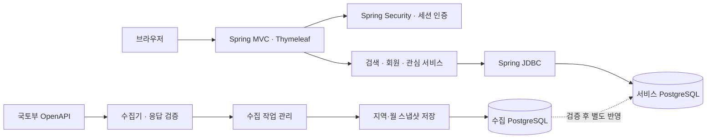

# 집결 | 공공데이터 기반 아파트 실거래가 조회 서비스

> 백엔드 개발 포트폴리오 · 프로젝트 기술 보고서
>
> 작성 기준: 2026-11-09 · 개인 프로젝트 · Java / Spring Boot / PostgreSQL

국토교통부 아파트 매매 실거래 API를 수집해 지역·기간·가격·면적별 조회를 제공하는 웹 서비스입니다. 외부 API 수집부터 데이터 정합성, 회원별 접근 제어, 컨테이너 실행과 배포까지 백엔드 서비스의 전체 흐름을 구현했습니다.

이 프로젝트는 **반복 수집 시 중복 방지, 실패 시 기존 데이터 보존, 회원별 데이터 격리**에 초점을 둡니다. 데이터 적재량과 검색 처리 성능은 구분하며, 대용량 성능 개선 완료를 주장하지 않습니다.

## 1. 프로젝트 개요

| 항목 | 내용 |
| --- | --- |
| 목적 | 실제 거래 데이터를 검색·비교할 수 있는 서비스 구축 및 수집·저장·운영 과정 검증 |
| 이용자 기능 | 조건 검색, 거래 상세, 동일 단지·면적 거래 이력, 회원가입·로그인, 계정별 관심 아파트 |
| 관리 기능 | 지역·월 수집 작업, 실패 내역, 재시도, 수집 범위 조회 |
| 데이터 출처 | 국토교통부 아파트 매매 실거래 OpenAPI |
| 수집 범위 | 전국 지역 코드 목록 기준 2023-11~2026-10 수집 진행 중. 전 지역·기간 완료 상태는 아님 |
| 실행 방식 | IntelliJ/Maven 개발 실행, Docker Compose 앱·DB 실행, AWS 배포 이력 |
| 개발 방식 | AI 코딩 도구를 활용한 구현과 코드 검토·자동 테스트·실행 검증 |

[배포 주소](https://3-107-167-57.sslip.io/) · [실행 안내](outputs/apartment-search/README.md) · [개발·PR 규칙](CONTRIBUTING.md)

배포 주소는 마지막 배포 시 사용한 주소이며 상시 운영을 보장하지 않습니다. AWS와 로컬은 별도 환경이며, 최신 로컬 기능이 모두 AWS에 배포된 것은 아닙니다.

## 2. 구현 범위

| 구분 | 구현 내용 | 확인 범위·제약 |
| --- | --- | --- |
| 거래 검색 | 지역·아파트명·계약 기간·가격·면적 필터, 정렬, 페이지네이션 | JDBC 바인딩 및 정렬 허용 목록 적용 |
| 거래 상세 | 거래 조건 및 동일 주소·단지·면적의 최근 거래 비교 | 표시된 데이터 범위의 비교이며 시세 예측 모델은 아님 |
| 회원·관심 목록 | 세션 로그인, 로그아웃, 회원별 DB 저장·조회·해제 | 관심 항목 최대 200개, 소유자는 서버 인증 정보로 결정 |
| 공공데이터 수집 | 페이지 검증, 지역·월 단위 저장, 중복 방지, 취소·정정 반영 | 전체 페이지 수신 후 트랜잭션으로 해당 구간 갱신 |
| 수집 관리 | 작업 상태·시도 횟수·유효시간, 실패 조회와 재시도 | 관리자 설정 시 활성화. 유효시간 만료 작업은 복구 처리 시 정리 |
| 아파트 지도 | 주소 검색 링크, 버튼 클릭 시 Kakao Maps 지연 로드 | 코드·설정 준비. 실제 JavaScript 키를 사용한 지도 표시 검증은 미완료 |

카카오 로그인, 가격 예측, 검색 캐시와 성능 개선은 완료된 기능에 포함하지 않습니다.

## 3. 시스템 구성

수집용 DB와 서비스 DB를 분리해 수집 실험이 기존 서비스 데이터를 바로 변경하지 않도록 운영합니다. 현재 로컬 수집 오케스트레이션에는 별도 스크립트가 사용되며, 완전한 운영 스케줄러로 제품화된 상태는 아닙니다.

| 영역 | 기술 | 적용 목적 |
| --- | --- | --- |
| 서버 | Java 21, Spring Boot 4.0.9, Spring MVC | HTTP 요청 처리와 서비스 구성 |
| 화면 | Thymeleaf, JavaScript, CSS | 서버 렌더링과 검색·관심 목록 UI |
| 인증 | Spring Security, BCrypt, 세션, CSRF | 비밀번호 보호와 사용자·관리자 권한 분리 |
| 저장소 | PostgreSQL 17, Spring JDBC, Flyway | SQL 제어, 트랜잭션, 스키마 변경 이력 관리 |
| 테스트 | JUnit 5, MockMvc, Testcontainers, Node.js | 기능·권한·실제 PostgreSQL 동작 검증 |
| 실행·배포 | Docker, Compose, AWS EC2, Caddy | 환경 재현과 HTTPS 배포 |
| CI | GitHub Actions | PR·main의 Java 및 PostgreSQL 통합 검증 |
| 준비 도구 | k6, Jenkinsfile | 부하 측정 및 별도 CI 확장용. 운영 성과로 계산하지 않음 |

## 4. 핵심 기술 설계

### 4.1 반복 수집과 중복 저장 방지

**문제:** 같은 지역·월을 재수집할 때 단순 INSERT는 거래를 중복 생성합니다. 반대로 거래 조건이 같다는 이유만으로 모두 제거하면 실제 복수 거래를 잃을 수 있습니다.

**적용:** 거래 내용의 해시, 지역 구분, 동일 내용의 등장 순번으로 `source_key`를 구성합니다. 기존 키는 갱신하고 없는 키는 추가하며, DB UNIQUE 인덱스로 중복 키 저장을 방어합니다. 수집마다 `snapshot_id`를 부여해 해당 지역·월에서 이번 결과에 없는 거래를 제거합니다.

**한계:** 공식 거래 ID가 아닌 내용 기반 식별자입니다. 원천 데이터의 표현 변경과 행정구역 변경은 별도 검토가 필요합니다.

[저장 구현](outputs/apartment-search/src/main/java/kr/aptfolio/collection/molit/MolitStore.java) · [PostgreSQL 검증 코드](outputs/apartment-search/src/test/java/kr/aptfolio/postgres/PostgresIT.java)

### 4.2 수집 실패 시 데이터 보존

**문제:** API 페이지 일부만 수신한 상태에서 기존 데이터를 교체하면 정상 거래가 누락될 수 있습니다.

**적용:** 페이지 번호·전체 건수·응답 항목 수를 검증하고 전체 조회를 마친 뒤 저장합니다. 거래 반영과 작업 성공 상태 변경을 같은 트랜잭션으로 묶습니다. DB 오류 시 변경을 롤백하며, 작업 잠금과 유효시간 검사로 중복 실행 및 만료 작업의 늦은 저장을 방어합니다.

**한계:** 프로세스 종료 후 재개와 장애 감지는 실행·복구 절차에 의존합니다. 자동 운영 감시 체계는 개선 대상입니다.

[수집 흐름](outputs/apartment-search/src/main/java/kr/aptfolio/collection/molit/MolitCollector.java) · [작업 관리](outputs/apartment-search/src/main/java/kr/aptfolio/collection/jobs/CollectionJobs.java)

### 4.3 회원별 관심 아파트 접근 제어

**문제:** 요청에 포함된 사용자 ID를 신뢰하면 다른 회원의 관심 데이터를 조회·삭제할 위험이 있습니다.

**적용:** 소유자를 세션의 인증 사용자로 결정하고 조회·삭제 조건에 사용자 식별자를 포함합니다. 사용자·아파트 키의 유일 제약과 사용자 행 잠금으로 중복 등록 및 저장 상한을 관리합니다. 변경 요청에 CSRF 검증을 적용합니다.

[관심 목록 설계](outputs/apartment-search/docs/bookmarks.md) · [로그인 설계](outputs/apartment-search/docs/user-login.md)

## 5. 검증 근거

| 검증 대상 | 검증 방식 | 근거 |
| --- | --- | --- |
| 조건 검색·잘못된 요청 | MockMvc 및 테스트 fixture | [웹 테스트](outputs/apartment-search/src/test/java/kr/aptfolio/trade) |
| 중복·정정·취소·롤백·동시 저장 | PostgreSQL 17 Testcontainers | [PostgresIT](outputs/apartment-search/src/test/java/kr/aptfolio/postgres/PostgresIT.java) |
| 인증·CSRF·회원별 관심 목록 | API 테스트 및 JavaScript 모의 실행 | [회원 테스트](outputs/apartment-search/src/test/java/kr/aptfolio/account) |
| 수집 실패·재시도·작업 상태 | 모의 응답과 작업 API 테스트 | [수집 테스트](outputs/apartment-search/src/test/java/kr/aptfolio/collection) |
| Docker 재시작 후 저장 유지 | Compose 기동, 데이터 조회, 재시작 후 재조회 | [CI 정의](.github/workflows/ci.yml) |
| AWS 배포 | 당시 HTTPS 응답·쿠키·DB 마이그레이션·백업 확인 | [2026-11-04 배포 기록](outputs/apartment-search/docs/deployment-20261104.md) |

테스트 코드는 검증 범위를 보여주는 근거이며, 특정 시점의 통과 기록과 현재 CI 결과는 구분합니다. 최신 실행 결과는 [GitHub Actions](https://github.com/sign0329/house_finder/actions)에서 확인할 수 있습니다. 이번 README 개편에서는 애플리케이션 테스트를 재실행하지 않았습니다.

## 6. 데이터·운영 현황

2026-11-09 문서 작성 중 각 DB의 `trade` 테이블을 직접 조회한 시점 기준입니다. 수집은 계속 진행되므로 현재 건수와 차이가 있을 수 있습니다.

| 환경 | 확인 건수 | 운영 구분 |
| --- | ---: | --- |
| 로컬 수집 DB | 459,130건 | 전국 거래 수집·확인용 |
| 로컬 서비스 DB | 129,728건 | 8082 웹 조회용 |
| AWS | 이번 작성에서 조회하지 않음 | 로컬 적재 데이터를 자동 배포하지 않음 |

두 로컬 DB는 데이터가 겹치므로 합산하지 않습니다. 건수는 조회 시점의 저장 행 수이며 전국 전체 거래의 완전성이나 처리 성능을 입증하는 지표는 아닙니다. 현재 서비스 DB로의 신규 거래 추가 방식은 취소·정정 내역의 완전한 동기화를 보장하지 않습니다.

## 7. 한계와 개선 계획

| 우선순위 | 현재 한계 | 다음 검증·개선 |
| --- | --- | --- |
| 1 | 수집 DB와 서비스 DB 간 추가 반영 중심 | 취소·정정까지 포함하는 동기화 정책과 복구 검증 |
| 2 | OFFSET + COUNT 검색, 성능 수치 미확보 | 고정 데이터셋에서 실행 계획·p95·처리량 측정 후 개선 전후 비교 |
| 3 | 지역·월마다 수집기 실행 비용 발생 | 여러 구간을 연속 처리하는 작업 실행 방식 검토 |
| 4 | 과거 행정구역 코드의 완전성 미확인 | 개편 전후 코드·기간별 누락 및 중복 검증 |
| 5 | 지도 실제 연동·카카오 로그인 미완료 | 외부 서비스 설정 후 실제 인증·지도 동작 확인 |

## 8. 개발 참여와 문서

AI 코딩 도구를 활용해 구현했습니다. 개발 과정에서 실행 환경 설정, Git 충돌 해결, 수집·배포 결과 확인을 진행했으며, 구현 전체를 독자 작성하거나 전체 개발 과정을 TDD로 수행했다고 주장하지 않습니다. 주요 코드와 테스트를 직접 설명·수정할 수 있도록 학습과 검증을 진행하고 있습니다.

- [프로젝트 실행·검증 안내](outputs/apartment-search/README.md)
- [공공 API 설정](outputs/apartment-search/docs/public-api.md)
- [수집 작업 설계](outputs/apartment-search/docs/collection-jobs.md)
- [Docker 실행](outputs/apartment-search/docs/docker.md)
- [지도 설정](outputs/apartment-search/docs/maps.md)
- [AI 활용 원칙](outputs/apartment-search/docs/ai-workflow.md)
- [GitHub Flow·PR 규칙](CONTRIBUTING.md)

API 키·DB 비밀번호·환경 파일·수집 데이터·백업은 저장소에 포함하지 않습니다.
