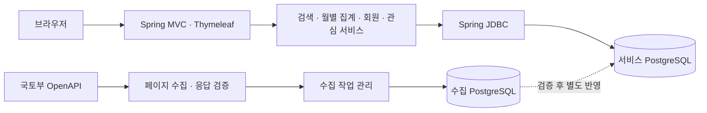
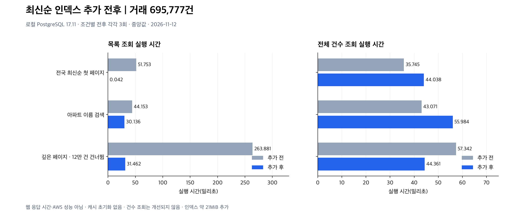

# 집결 | 공공데이터 기반 아파트 실거래가 조회 서비스

> 백엔드 개발 포트폴리오 · 검토 초안 · 2026-11-12 기준


## 프로젝트 요약

| 항목 | 설명 |
| :--- | :--- |
| 프로젝트 소개 | 국토교통부 실거래 데이터를 수집해 아파트 거래 검색·상세·월별 추이를 제공하는 웹 서비스임 |
| 개발 기간 | 진행 중임. 실제 개발 시작일 확인 필요. 최초 Git 커밋은 2026-10-26임 |
| 개발 인원 | 1인 개인 프로젝트임 |
| 사용 기술 | Java 21, Spring Boot, Spring Security, JDBC, PostgreSQL, Flyway, Thymeleaf, Docker, AWS EC2, GitHub Actions를 사용함 |
| 주요 기능 | 조건 검색, 거래 상세, 월별 가격·거래량 추이, 회원 로그인, 관심 아파트, 공공데이터 수집·실패 관리 기능을 구현함 |
| 담당 역할 | 요구사항 정의, 데이터 수집 범위 결정, 실행 환경 설정, Git 충돌 해결 및 수집·배포 결과 확인을 수행함. 구현과 테스트에 AI 코딩 도구를 활용함 |
| 실행 방법 | Maven으로 개발 서버를 실행하거나 Docker Compose로 앱과 PostgreSQL을 함께 실행함 |
| 영상 링크 | 시연 영상 링크 등록 여부 확인 필요 |
| 기술 설명 | 지역·월 단위 트랜잭션, 중복 저장 방지, 사용자별 접근 제어, 월별 집계, 검색 인덱스를 적용함 |
| 문제 해결 | API 키 이중 인코딩, 반복 수집 중복, 저장 실패 시 롤백, 최신순 검색의 전체 스캔·정렬 문제를 해결함 |

[배포 사이트](https://3-107-167-57.sslip.io/) · [실행 안내](outputs/apartment-search/README.md) · [GitHub Actions](https://github.com/sign0329/house_finder/actions)

## 1. 프로젝트 소개

국토교통부 아파트 매매 실거래 API를 수집하고, 저장된 거래를 지역·가격·기간·면적으로 검색하는 서비스임. 단순 조회를 넘어 반복 수집의 정합성, 장애 시 데이터 보존, 회원별 데이터 격리와 검색 성능을 검증하는 데 목적이 있음.

로컬 서비스 DB는 2026-11-12 성능 측정 시 695,777건을 확인함. AWS 서비스 DB는 2026-11-11 데이터 반영 후 동일 건수와 HTTPS 조회를 확인함. 두 환경의 데이터를 합산하지 않으며, 전국 모든 지역·기간의 수집 완료를 의미하지 않음.

배포 사이트는 상시 운영을 보장하지 않음. 월별 추이와 최신순 인덱스는 코드 구현·로컬 검증을 완료했으나, 이번 작업 흐름에서 AWS에 배포하지 않았음.

## 2. 개발 기간

- 개발 상태: 기능 개발 및 검증 진행 중임.
- 실제 개발 시작일: 작성자 확인 후 기재 예정임.
- 최초 Git 커밋: 2026-10-26임. 개발 시작일과는 구분함.
- 최근 작업: 2026-11-12 기준 검색 인덱스 전후 비교와 월별 거래 추이 기능 검증을 완료함.

## 3. 개발 인원

1인 개인 프로젝트임. AI 코딩 도구를 구현·테스트 보조에 활용함.

## 4. 사용 기술

| 구분 | 기술 | 적용 내용 |
| :--- | :--- | :--- |
| 백엔드 | Java 21, Spring Boot 4.0.9, Spring MVC | 요청 처리와 서비스 로직을 구성함 |
| 인증 | Spring Security, BCrypt, 세션, CSRF | 사용자·관리자 인증과 변경 요청 보호에 적용함 |
| 데이터 | PostgreSQL 17, Spring JDBC, Flyway | SQL 조회, 트랜잭션, 스키마 변경 이력을 관리함 |
| 개발 DB | H2 | 외부 DB 없이 실행·테스트하는 환경에 사용함 |
| 화면 | Thymeleaf, JavaScript, CSS | 검색·상세·관심 목록과 거래 추이 화면을 구현함 |
| 테스트 | JUnit 5, MockMvc, Testcontainers | 요청 검증과 실제 PostgreSQL 동작을 확인함 |
| 배포 | Docker Compose, AWS EC2, Caddy | 앱·DB 실행 환경과 HTTPS 배포에 사용함 |
| CI | GitHub Actions | PR과 main의 자동 테스트를 실행함 |

k6와 Jenkinsfile은 확장용 설정·스크립트가 준비된 상태임. 실제 부하 테스트나 Jenkins 운영 성과로 포함하지 않음.

## 5. 주요 기능

| 기능 | 구현 내용 |
| :--- | :--- |
| 실거래가 검색 | 지역·아파트명·기간·가격·면적 조건, 정렬, 페이지네이션을 제공함 |
| 거래 상세 | 개별 거래 조건과 같은 단지·주소·면적의 최근 거래를 제공함 |
| 월별 거래 추이 | 6개월·1년·3년 평균 가격과 거래량 그래프, 평균·최저·최고 가격 표를 제공함 |
| 회원 계정 | 회원가입·로그인·로그아웃·내 계정 조회를 제공함 |
| 관심 아파트 | 로그인한 회원별 저장·조회·해제를 제공함. 회원당 최대 200개로 제한함 |
| 공공데이터 수집 | 지역·월별 페이지 수집, 응답 검증, 중복 방지 및 스냅샷 갱신을 수행함 |
| 수집 관리 | 작업 상태·실패 내역·재시도·수집 범위를 조회함. 관리자 설정 시 활성화함 |

지도는 주소 검색 링크와 Kakao Maps 지연 로드 코드를 준비했으며, 실제 지도 키를 사용한 검증은 미완료임. 카카오 로그인과 가격 예측은 미구현임.

## 6. 담당 역할

개인 프로젝트로 요구사항과 수집 범위를 결정하고, 실행 환경 설정·Git 충돌 해결·수집 결과 확인·배포 확인을 수행함. AI 코딩 도구를 활용해 서비스 코드, 테스트와 문서를 작성·수정함.

핵심 코드를 직접 설명하고 수정할 수 있도록 트랜잭션과 실행 계획을 학습 중임. 전체 코드를 독자 작성하거나 모든 기능을 TDD로 개발했다고 표현하지 않음.

[AI 활용 원칙](outputs/apartment-search/docs/ai-workflow.md) · [개발·PR 규칙](CONTRIBUTING.md)

## 7. 실행 방법

Java 21 환경에서 저장소 루트 기준으로 실행함.

```sh
cd outputs/apartment-search
sh ./mvnw spring-boot:run
```

[localhost:8080](http://localhost:8080)으로 접속함. 기본 실행 DB는 빈 메모리 H2이므로 실제 수집 데이터를 보려면 PostgreSQL 연결 설정이 필요함.

Docker Desktop을 실행한 경우 아래 명령으로 앱과 DB를 함께 실행함.

```sh
cd outputs/apartment-search
# 최초 한 번만 복사하며, 기존 파일이 있으면 덮어쓰지 않음
cp .env.example .env.docker
# .env.docker의 DB_PASSWORD 설정 후 실행함
sh scripts/stack.sh up
```

[localhost:8082](http://localhost:8082)로 접속함. 새 DB에는 거래가 자동 적재되지 않으며, 데이터는 Docker 볼륨에 보관함.

```sh
# 기본 검증
sh ./mvnw verify
# Docker가 필요한 PostgreSQL 통합 검증
sh ./mvnw -Ppostgres-it verify
```

[환경 설정](outputs/apartment-search/docs/development.md) · [Docker 실행](outputs/apartment-search/docs/docker.md) · [공공 API 설정](outputs/apartment-search/docs/public-api.md)

## 8. 영상 링크

시연 영상 링크 등록 여부 확인 필요함.

영상 구성안은 검색 → 거래 상세·기간별 추이 → 로그인·관심 아파트 → 관리자 수집 실패 조회 순서임. 실제 영상 링크 확인 후 추가 예정임.

## 9. 기술 설명



| 설계 | 구현 방식 |
| :--- | :--- |
| 중복 저장 방지 | 거래 내용·지역·동일 내용 등장 순번으로 source_key를 구성하고 UNIQUE 인덱스로 중복을 방어함 |
| 저장 원자성 | 전체 페이지 검증 후 지역·월 거래 반영과 작업 성공 기록을 같은 트랜잭션으로 처리함 |
| 회원별 데이터 격리 | 요청의 사용자 ID 대신 세션 인증 정보를 기준으로 관심 목록 소유자를 결정함 |
| 월별 집계 | 같은 단지·주소·정확한 면적을 SQL로 집계함. 거래 없는 달은 가격 없음과 거래량 0으로 구분함 |
| 최신순 검색 | 지역 조건 없는 조회를 위해 (deal_date DESC, id DESC) 인덱스를 추가함 |

월별 추이 기능 검증 시 기본 테스트 84개와 PostgreSQL 통합 테스트 17개가 통과함. 특정 버전의 로컬 실행 기록이며 현재 CI 상태는 별도로 확인함.

[수집 작업 설계](outputs/apartment-search/docs/collection-jobs.md) · [월별 추이 기준](outputs/apartment-search/docs/monthly-trends.md) · [관심 목록 설계](outputs/apartment-search/docs/bookmarks.md)

## 10. 문제 해결 — 트러블슈팅 보고서

### 서론: 문제 발생 배경과 분석 범위

공공데이터를 수집해 검색 서비스로 제공하는 과정에서 API 인증 처리, 반복 수집의 정합성, 저장 실패 시 데이터 보존, 검색 성능을 검토함. 데이터 규모가 커질수록 단순한 기능 동작 여부만으로 안정성을 판단하기 어려워, 실제 호출 결과와 PostgreSQL 통합 테스트, SQL 실행 계획을 근거로 원인을 분석함.

본 보고서는 실제로 확인한 API 호출 문제와 검색 실행 계획, 테스트로 검증한 정합성·권한 보호 사례를 구분해 정리함. 중복 저장·부분 저장·다른 회원 데이터 접근은 검증한 위험 시나리오이며, 모두 실제 운영 장애가 발생했다는 의미는 아님.

### 본론: 원인 분석과 해결 과정

#### 1) 공공 API 호출 실패 — 인증키 이중 인코딩

**현상:** 국토교통부 API 연결 과정에서 호출 실패가 발생함. 인증키 문제와 환경 문제를 구분하기 위해 요청 URL의 인증키 처리 경로를 점검함.

**원인:** 이미 URL 인코딩된 인증키를 요청 생성 단계에서 다시 인코딩하면 원래 키와 다른 값이 전달될 수 있음. 예를 들어 `%2F`가 `%252F`로 바뀌는 형태임.

**조치:** 인코딩된 키를 정규화한 뒤 요청 URL을 구성할 때 한 번만 인코딩하도록 처리 경로를 정리함. 인증키 원문을 로그나 문서에 남기지 않도록 함.

**검증:** 인증키 처리 수정 후 실제 API 수집을 확인함. 다만 인증 실패 전체를 이중 인코딩 문제로 단정하지 않으며, 호출 한도·네트워크·서비스 응답 오류는 별도로 구분해야 함.

[API 클라이언트](outputs/apartment-search/src/main/java/kr/aptfolio/collection/molit/MolitClient.java) · [API 연결 안내](outputs/apartment-search/docs/public-api.md)

#### 2) 반복 수집과 저장 실패 — 중복·부분 반영 방지

**검증 상황:** 같은 지역·월을 반복 수집하거나, 정상 거래를 저장한 뒤 음수 가격 등 잘못된 거래로 DB 오류가 발생하는 상황을 검증함. 단순 추가 저장은 중복을 만들고, 일부 행만 반영되면 해당 월의 데이터가 불완전해질 수 있음.

**원인 분석:** 중복 여부를 판별할 기준과 저장 단위의 원자성이 필요함. 또한 전체 API 페이지를 받기 전에 기존 데이터를 교체하면 미수신 거래가 삭제될 위험이 있음.

**조치:** 거래 내용·지역·동일 내용의 등장 순번으로 `source_key`를 구성하고 UNIQUE 인덱스로 중복을 방어함. 전체 페이지 검증 후 지역·월 단위 스냅샷을 반영하며, 거래 변경과 작업 성공 기록을 같은 트랜잭션으로 묶음.

**검증:** PostgreSQL 통합 테스트에서 반복 수집, 정정·취소 반영, 저장 실패 시 롤백을 확인함. 같은 트랜잭션에서 먼저 추가한 정상 거래도 후속 저장 오류가 발생하면 롤백되어야 하며, 이전에 커밋된 거래는 유지되어야 함.

**남은 제약:** 내용 기반 키는 원천 데이터의 공식 거래 ID가 아님. 수집 DB에서의 스냅샷 갱신과 서비스 DB로의 중복 제외 추가 이관도 별개임. 현재 추가 이관 방식만으로 서비스 DB의 취소·정정까지 완전히 동기화했다고 볼 수 없음.

[저장 처리](outputs/apartment-search/src/main/java/kr/aptfolio/collection/molit/MolitStore.java) · [PostgreSQL 검증](outputs/apartment-search/src/test/java/kr/aptfolio/postgres/PostgresIT.java)

#### 3) 전국 최신순 검색 — 전체 스캔과 정렬 비용 개선

**현상:** 거래 695,777건을 대상으로 실행 계획을 확인한 결과, 전국 최신순 목록 조회에서 병렬 순차 스캔과 정렬이 발생함. 앞의 12만 건을 건너뛰는 페이지에서는 임시 디스크를 사용하는 정렬도 확인함.

**원인:** 기존 인덱스는 지역 또는 아파트명이 선행 열이었음. 지역 조건이 없는 전국 조회의 `ORDER BY deal_date DESC, id DESC`를 직접 지원하는 인덱스가 없었음.

**조치:** `(deal_date DESC, id DESC)` 인덱스를 추가하는 Flyway V9 마이그레이션을 작성함. 검색 SQL과 응답 형식은 유지하고, 같은 로컬 데이터에서 인덱스 추가 전후를 비교함.

**검증:** 목록 조회 계획이 새 인덱스의 Index Scan으로 바뀌고 별도 정렬이 사라진 것을 확인함. 첫 페이지와 뒤쪽 페이지의 거래 ID 집합이 유지되는지도 확인함. 다음 값은 2026-11-12 로컬 PostgreSQL에서 조건별 전후 각각 3회 실행한 목록 SQL 시간의 중앙값임.

| 검색 | 추가 전 | 추가 후 |
| :--- | ---: | ---: |
| 전국 최신순 첫 페이지 | 51.753밀리초 | 0.042밀리초 |
| 뒤쪽 페이지(12만 건 건너뜀) | 263.881밀리초 | 31.462밀리초 |



**측정 한계:** 캐시를 초기화하지 않았고 전후 실행 순서도 교차하지 않은 소규모 실험임. 목록 SQL 시간의 감소를 웹 전체 응답 시간이나 AWS 성능 개선율로 해석하지 않음. 전체 건수 조회와 OFFSET 비용은 남아 있음.

**운영 고려:** 인덱스 크기는 약 21MiB이며 쓰기 시 유지 비용이 추가됨. 일반 CREATE INDEX는 생성 중 쓰기를 차단하므로 운영 적용 전 수집 중지와 저장 공간 확인이 필요함. 이번 실험만으로 AWS 적용 완료를 의미하지 않음.

[재현 SQL·실행 계획·측정 결과](outputs/apartment-search/docs/reports/search-index-20261112/README.md)

#### 4) 회원별 관심 목록 — 소유자 검증

**검증 상황:** 요청에 포함된 사용자 ID를 신뢰할 경우 다른 회원의 관심 목록을 조회·삭제할 위험이 있음. 실제 침해 사고 사례가 아니라 접근 제어 검증 항목임.

**조치:** 세션의 인증 사용자로 소유자를 결정하고, 조회·삭제 SQL에 사용자 조건을 적용함. 변경 요청에는 CSRF 검증을 적용함.

**검증:** 인증 여부, 사용자별 데이터 격리와 변경 요청 보호를 테스트함. 사용자 입력을 신뢰하는 대신 서버의 인증 정보를 기준으로 접근 범위를 결정하도록 구성함.

[관심 목록 설계](outputs/apartment-search/docs/bookmarks.md) · [회원 인증 설계](outputs/apartment-search/docs/user-login.md)

### 결론: 해결 결과와 후속 과제

인증키 처리 경로를 정리해 실제 수집을 확인하고, 반복 수집과 저장 실패에 대한 정합성 검증을 추가함. 검색 성능은 데이터 건수만으로 판단하지 않고 실행 계획을 확인한 뒤, 최신순 인덱스 추가 전후를 비교함. 회원 데이터는 인증 사용자 기준으로 접근 범위를 제한함.

| 구분 | 확인한 결과 | 후속 과제 |
| :--- | :--- | :--- |
| API 연결 | 인증키 처리 수정 후 실제 수집을 확인함 | 오류 유형별 진단과 재시도 기록을 보강해야 함 |
| 데이터 정합성 | 수집 저장의 중복·정정·취소·롤백을 테스트함 | 서비스 DB까지 취소·정정을 동기화하고 복구 절차를 검증해야 함 |
| 검색 성능 | 로컬 목록 SQL의 인덱스 활용과 실행 시간 감소를 확인함 | HTTP 응답 시간·동시 사용자 처리량·쓰기 비용을 추가 측정해야 함 |
| 접근 제어 | 세션 사용자 기반 소유자 조건과 CSRF를 검증함 | 기능 확장 시 권한 회귀 테스트를 유지해야 함 |

현재 근거는 명시한 환경과 테스트 범위에 한정됨. 후속 작업은 수집 누락·지역 코드 개편 검증, 서비스 데이터 동기화, 운영 저장 공간 관리 순으로 보완할 계획임.
