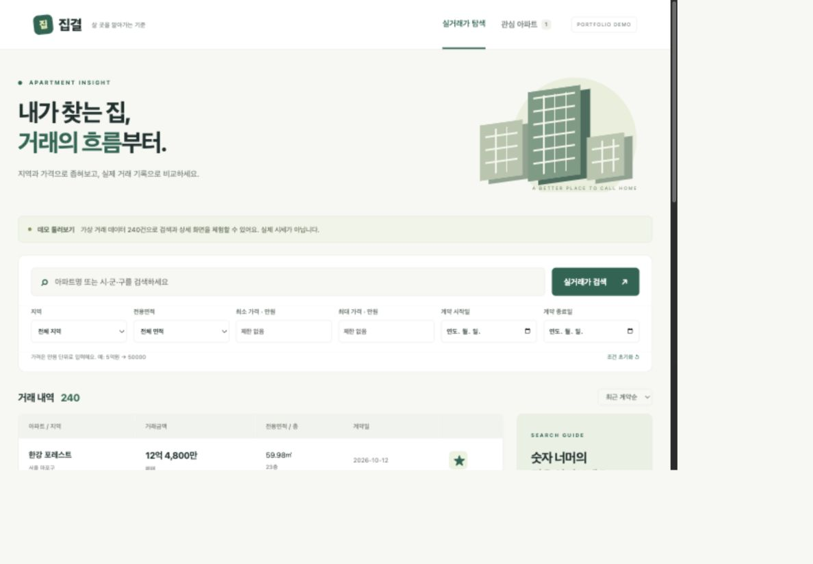
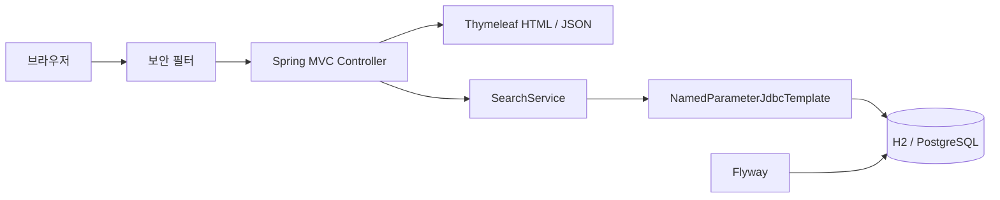

# 집결 — 아파트 실거래가 검색

지역·가격·면적·계약 기간으로 아파트 거래를 검색하고, 거래 상세와 동일 면적의 가격 흐름을 확인하는 웹 프로젝트입니다.

**현재 단계: 웹 MVP + 실제 국토부 데이터 연결. PostgreSQL에 종로구 2026년 9월 거래 32건을 저장하고 조회를 확인했습니다. 기본 demo는 가상 거래 240건이며, 대용량 성능·클라우드 배포는 미검증입니다.**

공공데이터를 가져오려면 [IntelliJ에서 첫 수집 실행](docs/public-api.md)을 참고하세요. 종로구의 선택한 계약월을 별도 로컬 DB에 저장합니다.



## 구현한 기능

- 지역, 단지명/시·군·구, 가격, 기간, 면적 조건 검색
- 최근순·가격순 정렬, 검색 조건을 유지하는 12건 단위 페이지 이동
- 거래 상세 및 동일 주소·단지·면적의 최근 최대 12건 비교
- 브라우저 localStorage 기반 관심 저장
- 잘못된 입력·없는 거래·빈 검색 결과 처리
- 보안 헤더, 요청 횟수 제한, SQL 쿼리 시간 제한

관심 저장은 계정 간 동기화를 지원하지 않습니다. 데모 DB는 서버 재시작 시 초기화됩니다. 공공데이터용 molit 프로필은 파일 DB에 저장합니다.

## 기술 구성

| 영역 | 사용 기술 | 적용 상태 |
| --- | --- | --- |
| 서버 | Java 21, Spring Boot 4.0.9, Spring MVC | 구현 |
| 화면 | Thymeleaf, CSS, JavaScript | 구현 |
| 데이터 접근 | Spring JDBC, Flyway | 구현 |
| 기본 실행 DB | H2 | 테스트·실행 확인 |
| 개발 DB | PostgreSQL 17 | 실제 거래 32건 저장·조회, 통합 테스트 7개 통과 |
| 테스트 | JUnit 5, MockMvc, Testcontainers | 기본 38개 + PostgreSQL 9개 통과 |
| CI | GitHub Actions | PR·main의 Java 테스트 실행 확인 |
| 컨테이너 | Docker, Compose | 앱·DB 실행, 실제 수집, 재시작 후 데이터 유지 확인 |
| 별도 CI | Jenkinsfile | 설정 준비, 실행 미검증 |
| 성능 실험 | k6 | 스크립트 준비, 측정 미실시 |
| 캐시 | Redis | 선택적 Compose 서비스만 준비 |

## 빠른 실행

macOS/Linux 셸, 패치된 JDK 21, curl, tar가 필요합니다. 최초 실행은 Maven과 의존성 다운로드를 위해 인터넷을 사용합니다.

```sh
# 저장소를 내려받은 뒤 프로젝트 루트에서 실행
# JDK 설치가 필요한 경우: Python 3.12+ 필요
python3 scripts/setup-java.py

./mvnw -v
./mvnw spring-boot:run
```

JDK가 이미 준비되어 있다면 설치 단계는 생략하고 JAVA_HOME을 설정하세요. 스크립트로 설치한 JDK는 프로젝트 `.tools/java-home`에 위치하며 `./mvnw`가 우선 사용합니다. 시스템 Java는 변경하지 않습니다.

[localhost:8080](http://localhost:8080)에 접속합니다. 기본 demo 프로필은 로컬 주소에만 바인딩하며 API 키와 Docker가 필요 없습니다. 실행 터미널에서 `Ctrl+C`로 종료합니다.

IntelliJ에서는 `pom.xml`을 Maven 프로젝트로 열고, Project SDK와 실행 구성 JRE를 패치된 JDK 21로 지정하세요. 프로젝트 JDK를 설치했다면 `.tools/java-home`를 사용하고 Maven 프로젝트를 다시 불러오세요. Windows에서는 JDK 21과 Maven을 설치하여 `mvn spring-boot:run`으로 실행할 수 있으나 이 환경은 검증하지 않았습니다.

## 검증

```sh
./mvnw verify
# 패키징된 의존성을 OSV에서 조회 (인터넷 필요)
python3 scripts/audit-dependencies.py
```

2026-10-26 API 연결 코드 추가 후 테스트 30개가 통과했습니다. 런타임 의존성 63개 조회에서 알려진 취약점 매칭은 0개였습니다. 이는 모든 취약점이 없다는 보장이 아닙니다. OSV 스크립트는 프로젝트 `.m2/repository`를 사용하므로 시스템 Maven을 사용하는 경우 `./mvnw -Dmaven.repo.local="$PWD/.m2/repository" package`로 먼저 빌드하세요.

[검증 기록](docs/verification.md) · [보안 보완 결과](docs/security-remediation-2026-10-26.md)

## 설계 개요



SQL과 실행 계획을 직접 관찰할 수 있도록 JDBC를 사용합니다. 현재 `OFFSET + COUNT`를 성능 비교의 기준으로 두고 있으며, 데이터가 커질 때의 비용은 아직 측정하지 않았습니다. 설계 근거와 한계는 [설계 결정 기록](docs/decisions/001-mvp-design.md)에 정리했습니다.

## API와 실행 환경

| 경로 | 기능 |
| --- | --- |
| `/` | 검색 화면 |
| `/trades/{id}` | 거래 상세 |
| `/saved` | 브라우저 관심 목록 |
| `/api/trades` | 검색 결과 JSON |
| `/actuator/health` | 서버 상태 |

[검색 파라미터](docs/api.md) · [Docker·환경 변수·부하 테스트 안내](docs/development.md)

## 다음 단계

1. 실제 데이터의 누락 필드 정책 검증과 지역 확장
2. 전국 지역 확장·정기 수집과 PostgreSQL 통합 테스트
3. 대량 테스트 데이터 생성과 실행 계획·부하 측정
4. 인덱스·페이지네이션·캐시 변경 전후 비교
5. CI 실행 검증, 클라우드 배포와 운영 관측

클라우드 리소스는 생성하지 않았습니다. 대용량 처리 성과는 측정 조건과 결과를 확보한 뒤 문서화할 예정입니다.

## 문서와 개발 방식

- [요구사항 및 구현 범위](docs/requirements.md)
- [구조와 데이터 모델](docs/architecture.md)
- [검증 결과와 미검증 범위](docs/verification.md)
- [AI 활용 및 검증 원칙](docs/ai-workflow.md)
- [GitHub 첫 업로드 안내](docs/publishing.md)
- [작업 규칙](AGENTS.md)

AI 코딩 도구를 활용해 구현하고 테스트·실행 결과로 변경을 검증했습니다. 초기 구현 전체를 TDD로 주장하지 않으며, 보안 보완에서는 신규 테스트 3개의 실패를 확인한 뒤 수정한 기록이 있습니다.

## Docker로 앱과 PostgreSQL 실행

Docker Desktop을 실행한 뒤 프로젝트 폴더에서:

```sh
cp .env.example .env.docker
# DB_PASSWORD 변경, 실제 수집은 MOLIT_SERVICE_KEY 설정
sh scripts/stack.sh up
sh scripts/stack.sh import
```

http://localhost:8082 접속. 키는 일회성 수집 컨테이너에만 전달하며 앱과 DB는 함께 실행됩니다. 이미 `.env.docker`가 있으면 복사하지 말고 기존 설정을 사용하세요.

[전체 Docker 실행·종료·데이터 유지 안내](docs/docker.md)
## PostgreSQL 개발 환경

[PostgreSQL 실행 및 테스트 안내](docs/postgresql.md). Docker의 전용 DB를 5433 포트에 실행하고 IntelliJ 앱을 8081 포트로 연결할 수 있습니다. 기본 H2 실행과 별도이며, `sh scripts/test-postgres.sh`로 실제 PostgreSQL 통합 테스트를 실행합니다.

## 지역·기간 수집 확장

`molit.regions`에 코드:시도:시군구 목록, `molit.from`/`molit.to`에 계약월 범위를 지정할 수 있습니다. 기존 단일 월 실행도 유지합니다. [실행 예시·실패 구간 재실행](docs/public-api.md#여러-지역기간-수집)을 참고하세요.

## 전국 시도 조회

검색 화면에서 전국 17개 시도를 선택할 수 있습니다. 전체 지역은 저장된 모든 거래를 조회하며, 시도 축약명과 공식 명칭을 함께 검색합니다. 미수집 지역·기간은 결과가 없을 수 있습니다. 전국 데이터 자동 수집 완료를 의미하지 않습니다.

## 기본 서버 배포 준비

Caddy 자동 HTTPS, 앱·DB 포트 비공개, 로컬 환경변수 파일, DB 백업 스크립트를 추가했습니다. [서버 준비·실행·백업·복원 안내](docs/deployment.md)를 따르세요. 아직 서버나 도메인을 생성하거나 공개 배포하지 않았습니다.
