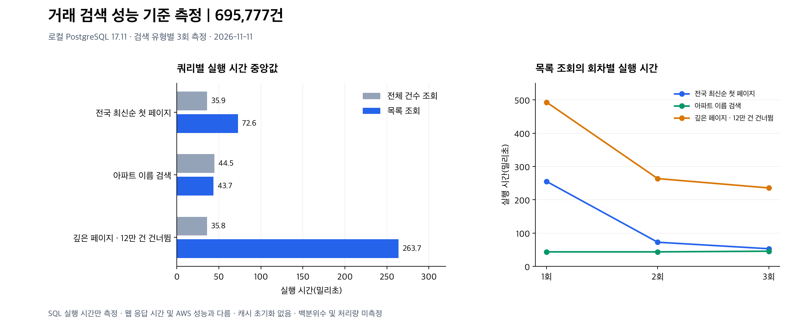

# 거래 검색 성능 기준 측정

측정일: 2026-11-11 (KST). 애플리케이션 기준 커밋: `1ed731a`.

## 목적과 환경

실거래 695,777건을 대상으로 개선 전 SQL 실행 계획을 기록했다. 로컬 Docker의 `house-finder-stack-db-1`, PostgreSQL 17.11(aarch64), 거래일 2023-11-01~2026-10-31 데이터다. AWS 운영 서버나 국토부 API에 부하를 가하지 않았다.

`SearchService.search`는 COUNT와 목록 SELECT를 순서대로 실행한다. 같은 조건의 두 쿼리를 EXPLAIN (ANALYZE, BUFFERS, FORMAT JSON)으로 각각 측정했다. 시나리오는 3개이며 각각 3회 실행했다. 캐시를 초기화하지 않았으며 첫 실행도 포함했다. 아래 값은 각 쿼리 Execution Time의 중앙값이다. HTTP 응답 시간, 동시 사용자 처리량 또는 p95를 의미하지 않는다. 개발 PC의 다른 작업과 캐시 상태에 영향을 받는 소규모 기준 측정이다.

| 시나리오 | 전체 건수 조회 중앙값(밀리초) | 목록 조회 중앙값(밀리초) | 목록 조회 3회 범위(밀리초) |
|---|---:|---:|---:|
| 전국 최신순 첫 페이지 | 35.895 | 72.604 | 53.037~255.065 |
| 한화포레나인천구월 부분 일치 | 44.536 | 43.662 | 43.655~45.642 |
| 전국 최신순 뒤쪽 페이지(12만 건 건너뜀) | 35.753 | 263.698 | 235.652~492.947 |

## 측정 결과 시각화



왼쪽은 전체 건수 조회와 목록 쿼리의 중앙값을 분리한 막대그래프다. 오른쪽은 목록 쿼리의 실행 순서별 관측값이다. **두 그래프는 개선 전의 동일한 측정값**이며, 오른쪽 선의 감소를 최적화 성과로 해석하지 않는다. 캐시를 통제하지 않아 감소 원인을 캐시 하나로 확정할 수도 없다. 그래프의 시간축은 0에서 시작한다.

| 그래프 표시 | 의미 |
|---|---|
| 전체 건수 조회 / 목록 조회 | 전체 결과 건수 조회 / 12개 거래 목록 조회 |
| 전국 최신순 첫 페이지 | 전국 최신순 첫 페이지 |
| 아파트 이름 검색 | 한화포레나인천구월 부분 일치 검색 |
| 깊은 페이지 · 12만 건 건너뜀 | 페이지 번호 10,000(0부터 시작), 앞의 120,000건을 건너뛴 조회 |

### 회차별 목록 조회 시간

| 시나리오 | 1회(밀리초) | 2회(밀리초) | 3회(밀리초) |
|---|---:|---:|---:|
| 전국 최신순 첫 페이지 | 255.065 | 72.604 | 53.037 |
| 아파트 부분 일치 | 43.655 | 43.662 | 45.642 |
| 깊은 페이지 | 492.947 | 263.698 | 235.652 |

### 이 측정으로 확인한 범위

| 확인한 내용 | 아직 확인하지 않은 내용 |
|---|---|
| 로컬 DB의 SQL 실행 시간과 실행 계획 | AWS 운영 환경의 응답 시간 |
| 3회 관측값과 중앙값, 변동 범위 | 95·99백분위 응답 시간, 동시 사용자 처리량 |
| 깊은 페이지의 임시 디스크 정렬 | 인덱스 추가 후 실제 개선 효과 |

[확대 가능한 SVG](search-baseline.svg) · [그래프 생성 코드](render_charts.py)

## 관찰 및 다음 실험

- 전국 최신순 목록은 병렬 순차 스캔과 정렬을 사용했다. 현재 인덱스 `(region, deal_date DESC, id DESC)`는 지역 조건 없는 정렬을 직접 지원하지 않는다. 다음으로 `(deal_date DESC, id DESC)` 인덱스를 로컬에서 비교할 가치가 있다. 효과는 아직 검증하지 않았다.
- 부분 일치 검색도 순차 스캔을 사용했다. `%검색어%`와 apartment/district OR 조건이 있다. 현재 측정만으로 전문 검색 시스템이나 캐시 도입을 결정하지 않는다.
- 깊은 페이지는 external merge 정렬과 임시 디스크 블록 읽기/쓰기가 발생했다. 최신순 인덱스 실험 후에도 OFFSET에 따른 비용이 남는지 확인하고, 필요하면 커서 페이지네이션을 검토한다.
- 전체 COUNT 비용은 목록 인덱스만으로 해결된다고 보장할 수 없다. 목록과 COUNT 시간을 분리해 계속 기록한다.

이번 작업은 측정과 문서화만 수행했다. 앱 코드·DB 인덱스·운영 설정을 변경하지 않았다. 이 결과를 AWS 서버 성능으로 표현해서는 안 된다.

## 재현

앱 프로젝트 폴더에서 로컬 DB를 실행한 후 다음 명령을 각 SQL 파일에 대해 3회 실행한다. 데이터 수와 PostgreSQL 설정이 같아야 비교가 의미 있다. SQL은 읽기 전용 트랜잭션, 30초 문장 제한을 사용한다.

```sh
docker exec -i house-finder-stack-db-1 psql -X -q -A -t -v ON_ERROR_STOP=1 -U apartments -d apartments < docs/reports/search-baseline-20261111/all_recent.sql
```

- [전국 최신순 SQL](all_recent.sql)
- [아파트 검색 SQL](apartment_keyword.sql)
- [깊은 페이지 SQL](deep_page.sql)
- [9회 측정의 COUNT·목록 실행 계획 원본](plans.json)

기존 인덱스: trade_pkey(id), idx_trade_region_date(region, deal_date DESC, id DESC), idx_trade_apartment_date(apartment, deal_date DESC, id DESC), idx_trade_source_key(source_key, UNIQUE), idx_trade_source_region_month(source, source_region, source_month).

검증: SQL 3종 각 3회 실행 성공, JSON 실행 계획 18개 파싱 성공. 앱 동작 변경이 없어 Java 테스트는 이번 로컬 작업에서 재실행하지 않았다. PR 필수 CI는 별도로 확인해야 한다.

### 그래프 재생성

한글 글꼴(맑은 고딕, Apple SD Gothic Neo, Noto Sans CJK KR, 나눔고딕 중 하나)과 별도 Python 환경의 `matplotlib`을 설치한 뒤 이 폴더의 `render_charts.py`를 실행한다. `plans.json`만 읽어 PNG와 SVG를 생성하며 DB나 네트워크에 접속하지 않는다. 앱 실행 의존성에는 추가하지 않았다. SVG는 글자를 경로로 저장하므로 보는 사람의 한글 글꼴 설치 여부에 영향을 받지 않는다.

```sh
python render_charts.py
```
