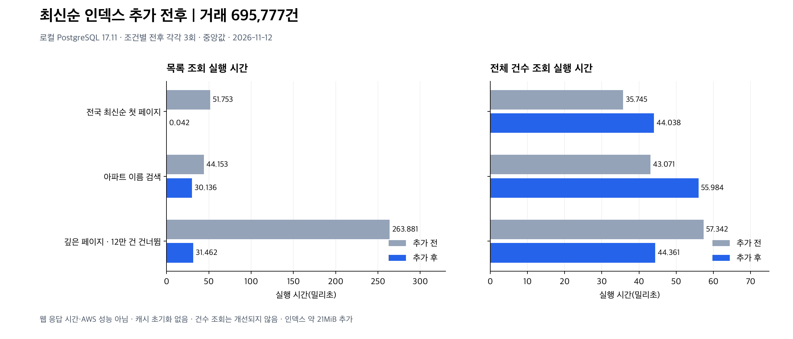

# 전국 최신순 검색 인덱스 비교

측정일: 2026-11-12(KST). 기준 코드: `15ce0f0`. 로컬 PostgreSQL 17.11(aarch64), 실제 거래 695,777건. 이전 날짜의 수치와 섞지 않고 같은 세션에서 추가 전후를 다시 측정했다.

## 문제와 변경

전국 검색에는 지역 조건이 없는데 기존 최신순 인덱스는 지역 또는 아파트 이름이 첫 열이었다. 실행 계획에서 병렬 순차 스캔 및 정렬을 확인했다. V9 마이그레이션으로 `(deal_date DESC, id DESC)` 인덱스를 추가한다. 검색 SQL과 응답 형식, 페이지 번호는 변경하지 않는다.



각 막대는 3회 실행 시간의 중앙값이며 두 패널의 가로축 범위가 다르다. 캐시를 초기화하지 않았고 전후 실행 순서를 교차하지 않았다. 인덱스 생성도 캐시에 영향을 준다. 이 소규모 실험으로 지연 시간 보장이나 동시 사용자 처리량을 주장하지 않는다. 특히 0.042ms는 로컬 목록 SQL 한 개의 측정값으로 웹 응답 시간과 다르다.

## 결과

| 검색 | 목록 전(밀리초) | 목록 후(밀리초) | 건수 조회 전(밀리초) | 건수 조회 후(밀리초) |
|---|---:|---:|---:|---:|
| 전국 최신순 첫 페이지 | 51.753 | 0.042 | 35.745 | 44.038 |
| 아파트 이름 검색 | 44.153 | 30.136 | 43.071 | 55.984 |
| 깊은 페이지(12만 건 건너뜀) | 263.881 | 31.462 | 57.342 | 44.361 |

### 목록 조회 원본 관측값

| 검색 | 단계 | 1회(밀리초) | 2회(밀리초) | 3회(밀리초) |
|---|---|---:|---:|---:|
| 전국 최신순 첫 페이지 | 추가 전 | 87.298 | 51.753 | 51.502 |
| 전국 최신순 첫 페이지 | 추가 후 | 0.080 | 0.042 | 0.036 |
| 아파트 이름 검색 | 추가 전 | 44.153 | 44.831 | 44.053 |
| 아파트 이름 검색 | 추가 후 | 50.793 | 29.722 | 30.136 |
| 깊은 페이지(12만 건 건너뜀) | 추가 전 | 314.767 | 258.312 | 263.881 |
| 깊은 페이지(12만 건 건너뜀) | 추가 후 | 34.836 | 30.986 | 31.462 |

## 실행 계획과 비용

- 세 조건 모두 목록 조회에서 `idx_trade_recent_date`의 Index Scan을 사용했다. 전국 최신순의 별도 정렬이 사라졌다.
- 전체 건수 조회는 뚜렷한 일관된 개선이 없었다. 앱은 건수와 목록을 순차 조회하므로 목록 SQL의 개선율을 전체 API 개선율로 표현하지 않는다.
- 부분 문자열 조건 자체를 인덱스로 찾는 것은 아니다. 최신순 인덱스를 읽으며 이름 조건을 필터링한다. 다른 검색어, 특히 매칭이 적거나 없는 경우에는 불리할 수 있어 별도 평가가 필요하다.
- OFFSET은 여전히 앞의 행을 읽고 버린다. 깊은 페이지가 공짜가 된 것은 아니다.
- 인덱스 크기: 21,970,944바이트(약 20.95MiB). 삽입·삭제·갱신 시 인덱스 유지 비용이 추가된다. 쓰기 처리량은 이번에 측정하지 않았다.

## 적용 상태와 운영 제약

실험은 단일 트랜잭션 안에서 인덱스를 생성하고 마지막에 ROLLBACK했다. 따라서 기존 로컬 서비스 DB와 AWS 운영 DB에는 이 인덱스를 영구 적용하지 않았다. 새 앱 버전을 실행하면 Flyway V9가 적용된다.

일반 CREATE INDEX는 생성 중 쓰기를 차단한다. 운영 적용 시 수집 작업을 멈추고 여유 공간을 확인한 뒤 유지보수 시간에 적용한다. 현재 AWS 디스크가 작은 상태이므로 이 PR을 운영에 자동 배포하지 않았다. 인덱스를 적용한 후 앱만 이전 버전으로 되돌려도 인덱스는 남으며, 기존 SQL과 호환된다. 적용된 V9 파일을 수정하거나 Flyway 이력을 임의로 지우지 않는다.

## 재현 및 검증

[compare.sql](compare.sql)은 로컬 전용 실험이다. 동일 이름의 인덱스가 이미 있으면 실패하도록 했으며 기존 인덱스를 삭제하지 않는다. 비교 도중에는 쓰기 잠금이 걸릴 수 있으므로 수집과 함께 실행하지 않는다.

```sh
docker exec -i house-finder-stack-db-1 psql -X -q -A -t -v ON_ERROR_STOP=1 -U apartments -d apartments < docs/reports/search-index-20261112/compare.sql
```

- 검색 3종 × 전후 × 3회: COUNT·목록 실행 계획 총 36개 저장.
- 첫 페이지·깊은 페이지의 기존 거래 ID 집합이 유지되는지 SQL에서 검증.
- V9를 적용한 격리된 PostgreSQL 테스트에서 인덱스 열과 내림차순 정의 확인. 기존 H2 및 검색 기능 테스트도 필수 Maven 검증에 포함.
- 테스트 실행 결과는 아래에 기록한다. HTTP 부하 테스트 및 쓰기 성능 테스트는 수행하지 않았다.

[실행 계획 원본](plans.json) · [확대용 SVG](comparison.svg) · [그래프 생성 코드](render_charts.py) · [기존 기준 보고서](../search-baseline-20261111/README.md)

그래프는 기존 보고서와 같은 matplotlib 및 한글 글꼴 환경에서 `python render_charts.py`로 재생성한다.

검증 결과: Java 21.0.13에서 `mvn -Ppostgres-it verify` 성공. 기본 테스트와 PostgreSQL 통합 테스트 16개 모두 오류 없이 통과했다. 최초 통합 실행은 Docker Desktop 소켓 마운트 설정 때문에 실패했고, `TESTCONTAINERS_DOCKER_SOCKET_OVERRIDE=/var/run/docker.sock`를 지정한 재실행에서 성공했다. 도메인 규칙 변경이 아니며 테스트 선실패(TDD) 증거를 주장하지 않는다.
